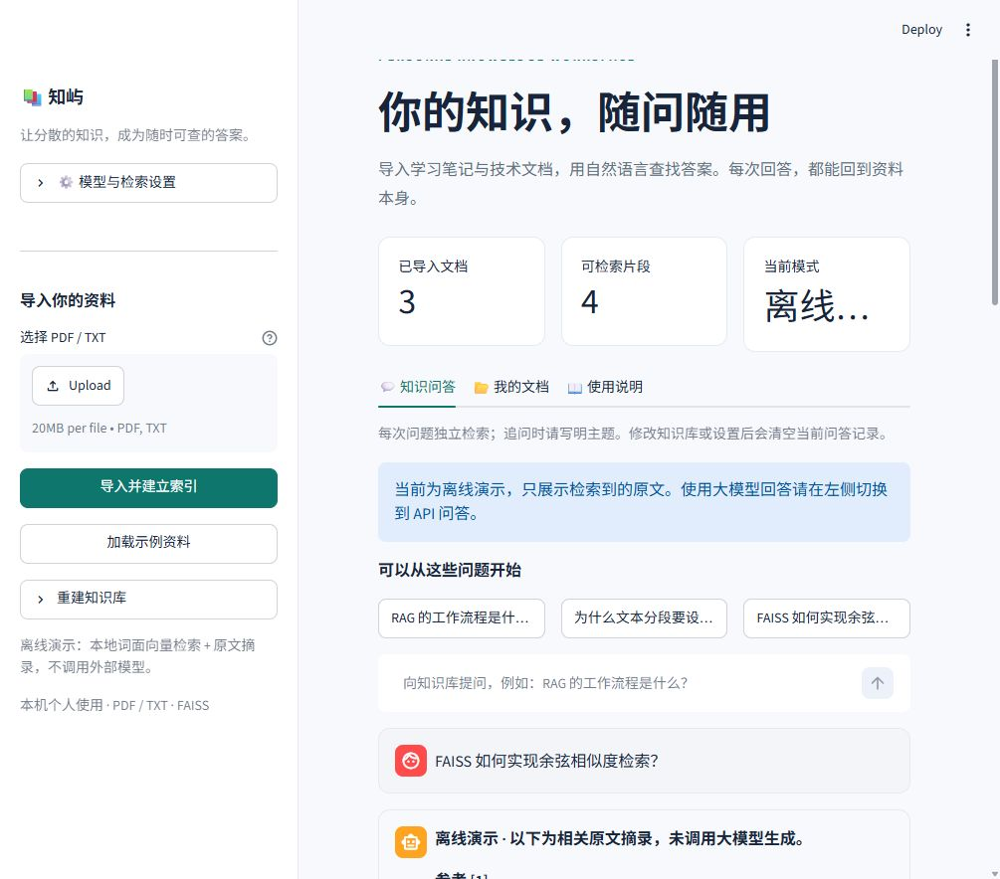
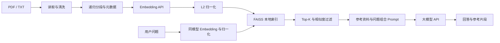

# 知屿：基于 RAG 的个人知识库问答系统

Python + LangChain + FAISS + Streamlit + OpenAI 兼容大模型 API。

导入 PDF、TXT 文档后，通过自然语言检索资料。在 API 模式下，系统将检索片段和问题一起交给大模型生成回答，并展示文件名、PDF 页码、原文片段与余弦相似度。



## 快速运行

本项目已在 Windows / Python 3.12 上验证，支持 Python 3.11～3.13。首次从 GitHub 获取项目，请先按下方“在其他电脑安装”创建 `.venv` 并安装依赖。

在 PowerShell 中运行：

```powershell
# 先进入已下载项目的根目录
.\.venv\Scripts\python.exe -m streamlit run app.py
```

打开 <http://127.0.0.1:8501>。也可以执行 `powershell -ExecutionPolicy Bypass -File .\start.ps1`。

首次使用时，点击左侧的“加载示例资料”，然后提问：

- RAG 的工作流程是什么？
- 为什么文本分段要设置重叠？
- FAISS 如何实现余弦相似度检索？

**默认离线演示不需要 API Key。** 此模式使用确定性的中文字符 n-gram / 英文词语哈希向量进行词面检索，回答为原文摘录，不代表语义 Embedding 或大模型生成效果。页面会明确标识。

也可以在终端验证整个离线流程：

```powershell
.\.venv\Scripts\python.exe -X utf8 -m rag.demo
.\.venv\Scripts\python.exe -X utf8 -m rag.demo --question "FAISS 如何实现余弦相似度检索？"
```

### 在其他电脑安装

```powershell
git clone https://github.com/jinhaonb2024-glitch/zhiyu-rag.git
cd zhiyu-rag
python -m venv .venv
.\.venv\Scripts\python.exe -m pip install -r requirements.txt
.\.venv\Scripts\python.exe -m streamlit run app.py
```

`requirements-lock.txt` 记录当前已验证环境的完整版本，包括测试工具。需要复现这一环境时，可将安装命令中的文件换成它。macOS / Linux 的虚拟环境解释器为 `.venv/bin/python`。

## 配置通用 OpenAI 兼容 API

可直接在左侧“模型与检索设置”中填写配置，选择“API 问答”并点击“应用设置”。页面输入的配置仅保存在当前浏览器会话，重启后需重新填写。

若需长期保存配置，复制 `.env.example` 为 `.env`：

```powershell
Copy-Item .env.example .env
```

编辑 `.env`，填入实际服务商提供的地址、密钥和模型名，重启 Streamlit：

```dotenv
RAG_MODE=api

LLM_API_KEY=你的问答服务密钥
LLM_BASE_URL=https://你的问答服务地址/v1
LLM_MODEL=服务商提供的聊天模型名

EMBEDDING_API_KEY=你的向量服务密钥
EMBEDDING_BASE_URL=https://你的向量服务地址/v1
EMBEDDING_MODEL=服务商提供的向量模型名
```

两组配置相互独立，可以来自不同厂商。聊天服务必须支持 `POST /chat/completions` 及 SSE 流式输出，向量服务必须支持 `POST /embeddings`。Base URL 填接口前缀，不要填完整的 `/chat/completions` 或 `/embeddings` 地址。

若两者使用同一个服务，可用 `OPENAI_API_KEY` 和 `OPENAI_BASE_URL` 提供公共后备配置。专用配置优先。`.env.example` 中的 OpenAI 模型名是可编辑的示例值，实际可用模型由你的服务商和账户决定。

应用不会调用模型列表接口，也不会擅自切换模型。API 模式会把文档片段发送到配置的 Embedding 服务，把问题及参考片段发送到问答服务；调用可能产生服务商费用。实际付费服务尚需使用你自己的密钥验证，自动化测试使用模拟 HTTP 响应验证真实客户端的调用路径。

### 调整检索参数

| 参数 | 默认值 | 含义 |
| --- | --- | --- |
| `CHUNK_SIZE` | 600 | 每个文本片段的最大字符数，非 token 数 |
| `CHUNK_OVERLAP` | 100 | 相邻片段的重叠上限，实际重叠取决于分隔符 |
| `TOP_K` | 4 | 最多检索的片段数量 |
| `MIN_SIMILARITY` | 0.12 | 最低余弦相似度，需根据资料和模型调试 |
| `MAX_CONTEXT_CHARS` | 10000 | 发送给大模型的参考资料字符预算 |
| `EMBEDDING_BATCH_SIZE` | 16 | 每批向量输入数，兼容服务限制较严时可设为 1 |
| `API_TIMEOUT` | 60 | 单次 API 请求超时秒数，失败最多重试 2 次 |

切换 Embedding 模型、服务地址或分段参数后，系统会拒绝直接使用旧索引。请恢复原配置，或选择全部文档后点击“重建知识库”。更改问答模型或检索阈值不需要重新生成文档向量。

## 项目报告

- [项目报告（PDF）](output/pdf/知屿_RAG个人知识库问答系统_项目报告.pdf)：实现流程、架构、方法原理、测试记录及工程注意事项。
- [项目报告文字稿](output/report/知屿_RAG个人知识库问答系统_项目报告.md)：可编辑的 Markdown 版本。

报告中的索引规模与真实服务导入记录是编制时的本机验证记录。仓库不包含 API 密钥、上传的私人资料或本地知识库索引；首次运行时请加载示例资料或自行导入文件。临时排版文件、虚拟环境和运行缓存也不提交。

## 已实现的功能

- PDF 按页读取并保留页码；TXT 支持 UTF-8、带 BOM 的 UTF-16、GB18030。
- Unicode NFKC 归一化、空白清洗、按中文标点递归分段，保存来源和片段位置。
- 调用 LangChain `OpenAIEmbeddings` 对接兼容服务，文本以字符串形式提交。
- 归一化文档和查询向量，使用 FAISS `IndexFlatIP` 做精确 Top-K 余弦相似度检索。
- SHA-256 内容去重、增量导入、显式重建；相同文件内容即使改名也不会重复入库。
- 本地索引持久化、重启恢复、Embedding 配置一致性检查、二进制校验。
- LangChain Prompt + ChatOpenAI + 输出解析器组成 RAG 链，流式展示回答。
- 引用编号、文件名、PDF 页码、相似度和参考原文展示；上下文截断后只展示实际发送的片段。
- 无匹配片段时直接提示资料不足；模型提示词要求依据资料回答并说明证据不足。
- 文档列表与预览、当前会话问答记录、Markdown 导出、常见 API 错误提示。
- 离线演示、示例资料、单元测试、API 适配集成测试与 Streamlit 页面测试。

提示词约束和引用不能保证回答永远正确。引用编号由模型生成，参考原文由检索管线提供；核对事实时请查看原文。

## 项目结构

```text
RAG/
├── app.py                    # Streamlit 中文页面
├── rag/
│   ├── config.py             # .env 配置及索引签名
│   ├── documents.py          # PDF/TXT 读取、清洗、分段
│   ├── providers.py          # Embedding、归一化和 ChatOpenAI
│   ├── knowledge_base.py     # FAISS 检索、增量导入和持久化
│   ├── qa.py                 # 上下文构建、Prompt、流式回答
│   ├── errors.py             # 用户可读的错误消息
│   └── demo.py               # 无密钥命令行演示
├── examples/                 # 3 份中文示例资料
├── tests/                    # 文档、检索、持久化、API 和页面测试
├── data/indices/             # 首次导入时生成，不提交到 Git
├── .streamlit/config.toml    # 本机监听、文件大小和主题
├── .env.example              # 无密钥配置模板
├── requirements.txt          # 运行依赖范围
├── requirements-dev.txt      # 测试与静态检查工具
├── requirements-lock.txt     # 已验证的完整依赖版本
└── start.ps1                 # Windows 启动脚本
```



### 存储与导入行为

索引分为 `data/indices/demo/knowledge.npz` 和 `data/indices/api/knowledge.npz`，两个模式互不混用。NPZ 内保存 FAISS 二进制索引及 JSON 元数据，以 `allow_pickle=False` 读取，不需要反序列化 Python 对象。FAISS 通过内存字节进行序列化，兼容含中文的目录。

每次导入先构建候选索引，再写临时文件并原子替换。向量 API 或写盘失败时，当前活动索引及已保存索引保持可用。上传的原始文件不另行落盘；保存内容包括提取后的原文片段、文件名、页码和必要的索引信息，不含密钥。

同名文件内容改变时作为新文档加入。需要移除旧版时，用完整的目标文档集合重建。批量导入中的无效文件会跳过并显示原因，其他有效文件仍可导入；重建时请核对导入报告。

每个文件最多 20 MB，每次最多 20 个文件，PDF 最多 500 页，知识库最多 10000 个片段。此原型使用精确检索，适合小型个人知识库；不宣称支持百万规模或生产级并发。

## 测试与验证

当前交付版本：**38 项自动化测试全部通过**，Ruff 静态检查及 `pip check` 通过。浏览器已实际验证示例知识库恢复、提问和参考原文展开，并使用硅基流动 `BAAI/bge-m3` 成功完成真实 PDF 导入。测试环境为 Windows、Python 3.12.7；DeepSeek 真实问答仍需实际提问验证。按[演示与验收清单](docs/演示与验收.md)可完成离线演示和真实 API 验收。

```powershell
.\.venv\Scripts\python.exe -m pip install -r requirements-dev.txt
.\.venv\Scripts\python.exe -m pytest -q
.\.venv\Scripts\python.exe -m ruff check app.py rag tests
```

若当前 Windows 环境的系统临时目录不可写，可指定项目内的临时目录：

```powershell
$env:PYTHONUTF8 = '1'
$env:TEMP = Join-Path (Get-Location) '.cache\tmp'
$env:TMP = $env:TEMP
New-Item -ItemType Directory -Force -Path $env:TEMP | Out-Null
.\.venv\Scripts\python.exe -m pytest -q --basetemp .cache\pytest-local
```

测试涵盖文本编码、PDF 页码、空白/扫描/加密/损坏文档、分段来源、检索排序、重复与增量导入、重建失败保护、中文路径恢复、索引不兼容、损坏文件和上下文预算。

API 测试通过 `httpx.MockTransport` 运行真实 LangChain/OpenAI 客户端，检查独立的两套地址/密钥、字符串 Embedding 请求、FAISS 检索、带参考资料的 Prompt、SSE 流式响应及恢复后不重复生成文档向量。此测试不代表已经验证任意第三方服务商的真实接口或模型质量。

页面回归测试同时覆盖 API 模式导入、生成回答、引用展示、导出入口、流式中断时保留部分回答并显示错误，以及新会话恢复索引时不调用 API。同名文件的不同内容分别预览，预览标题中的内容 ID 可用于区分版本。

## 常见问题

| 现象 | 处理方法 |
| --- | --- |
| `python` 打开商店或无法访问 | 用实际 Python 安装路径创建环境；当前项目直接用 `.venv\Scripts\python.exe` |
| PDF 提示无文本 | 扫描页需先做 OCR，再导入具有可选中文本的 PDF |
| 问答可用但无法建库 | 确认 Embedding 服务支持 `/embeddings`，配置正确的向量模型和密钥 |
| 硅基流动导入失败 | Base URL 填 `https://api.siliconflow.cn/v1`，不能填 `https://cloud.siliconflow.cn/me/models` 等控制台网页 |
| HTTP 400 / 404 | 检查模型名及 Base URL 前缀；必要时把 Embedding 批量大小设为 1 |
| HTTP 401 / 429 | 检查密钥、权限、额度或请求限制 |
| 没有检索结果 | 问题写明主题，补充相关资料，或适当降低相似度阈值 |
| 切换模型后提示索引不一致 | 恢复原 Embedding 配置，或选齐全部资料并重建知识库 |
| 修改 `.env` 后页面没更新 | 重启服务；已存在的系统环境变量优先于 `.env` |
| 8501 端口被占用 | 使用 `python -m streamlit run app.py --server.port 8502` |

这是单用户、本机学习原型：不包含 OCR、用户鉴权、多人数据隔离、跨会话对话记忆及自动检索质量评测。问答记录只在当前浏览器会话中保留，每个问题独立处理，追问需要写清楚主题。

## 对应项目经历与面试讲解

| 经历中的内容 | 实际实现位置 | 可以演示的证据 |
| --- | --- | --- |
| PDF/TXT 读取、清洗、分段 | `rag/documents.py` | 导入文件、片段预览、PDF 页码 |
| Embedding 与本地 FAISS 索引 | `rag/providers.py`、`rag/knowledge_base.py` | 切换 API 模式、持久化文件、重启恢复 |
| 检索结果结合问题生成回答 | `rag/qa.py` | 查看 Prompt、真实 API 模式回答及引用 |
| Streamlit 问答页面 | `app.py` | 导入、提问、来源展示、导出问答 |

建议实际接入自己的 API、导入个人资料并准备若干已知答案的问题，再描述“完成完整问答流程”。检索准确率、响应时延和节省时间等数字应基于自己的评测，不能从这个原型直接推断。

可按以下顺序讲解设计：为什么需要 RAG → 如何分段并保留出处 → 为什么对向量归一化 → 如何检索和构建 Prompt → 如何避免旧索引与新模型混用 → 用什么测试验证系统。

## 实现参考

- [LangChain OpenAIEmbeddings](https://docs.langchain.com/oss/python/integrations/embeddings/openai)：Embedding 接口和参数。
- [LangChain ChatOpenAI](https://docs.langchain.com/oss/python/integrations/chat/openai)：Chat Completions、Base URL 与流式调用。
- [FAISS 相似度与距离](https://github.com/facebookresearch/faiss/wiki/MetricType-and-distances)：归一化内积与余弦相似度的关系。
- [Streamlit 文件上传](https://docs.streamlit.io/develop/api-reference/widgets/st.file_uploader)、[聊天输入](https://docs.streamlit.io/develop/api-reference/chat/st.chat_input)：上传和问答交互。

本项目直接使用 FAISS 原生接口管理索引，LangChain 负责文档结构、分段、Embedding、Prompt 和聊天模型。这样避免依赖已经[停止维护的 langchain-community](https://github.com/langchain-ai/langchain-community/issues/674)。
