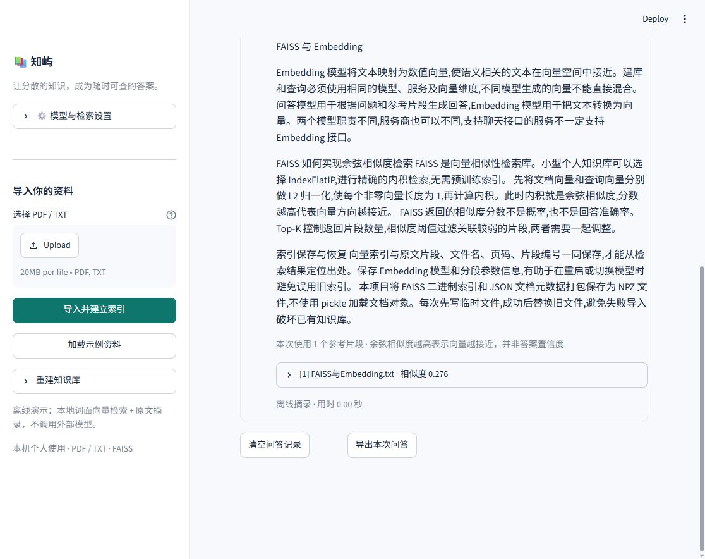

# 演示与验收

> 从 GitHub 下载项目时，仓库不包含个人上传的 PDF、API 密钥或已生成索引。请先按 README 启动，加载内置示例资料，或自行导入有权使用的文档。下文“现有 PDF / 索引”的配置与数量是本机历史验收示例；只有保留该索引的环境才能直接恢复，后续增补资料也会改变数量。

## 当前状态（2026-10-12）

- 文档处理、FAISS 检索、本地持久化、Streamlit 问答与来源展示已实现。
- 38 项自动化测试通过，Ruff 与依赖一致性检查通过。
- 浏览器已验证离线提问及参考原文展开。
- `E26106140096.pdf` 已通过硅基流动 `BAAI/bge-m3` 导入：112 个片段、1024 维向量。
- API 页面的成功回答和流式中断处理已通过模拟 HTTP 验证。真实 DeepSeek 回答尚未验收：密钥仅在旧浏览器会话中，当前会话需重新填写。

## 三分钟离线演示

1. 在项目目录执行 `powershell -ExecutionPolicy Bypass -File .\start.ps1`，打开 <http://127.0.0.1:8501>。
2. 保持“离线演示”，点击“加载示例资料”。已经导入的示例会自动跳过。
3. 提问“FAISS 如何实现余弦相似度检索？”。页面应显示相关原文摘录。
4. 展开回答下方的参考片段，核对文件名、相似度和原文；点击“导出本次问答”保存记录。
5. 打开“我的文档”查看文档和片段数量；刷新页面后文档应仍在。

离线模式展示的是检索原文，不能据此声称验证了大模型生成效果。



## 继续验收现有 PDF 的真实问答

在左侧“模型与检索设置”中配置两套服务：

| 配置项 | 填写内容 |
| --- | --- |
| 运行模式 | API 问答 |
| 问答 Base URL | `https://api.deepseek.com` |
| 问答模型名 | 当前 DeepSeek 账户可用的聊天模型名 |
| 问答 API Key | 自己的 DeepSeek 密钥 |
| Embedding Base URL | `https://api.siliconflow.cn/v1` |
| Embedding 模型名 | `BAAI/bge-m3` |
| Embedding API Key | 自己的硅基流动密钥 |
| 分段长度 / 重叠长度 | `600` / `100` |

点击“应用设置”。这些 Embedding 和分段参数与现有 PDF 索引一致，应直接恢复 1 个文档、112 个片段，**无需重新上传或重建**。加载索引本身不调用 Embedding API。

随后自行提交问题，例如：

> 请根据这份 PDF，总结其主要内容，并为重要结论标注参考资料编号。

提问会把问题发送到硅基流动生成查询向量，并把问题和检索到的 PDF 片段发送到 DeepSeek，可能产生对应服务商费用。

验收时检查：

- 回答逐步显示，结束后没有错误提示。
- 回答中的引用编号能对应到下方参考片段。
- 展开片段可以看到 `E26106140096.pdf`、PDF 页码和原文。
- 回答的主要结论能从这些原文中找到依据。引用是否充分需要人工核对。
- 导出的 Markdown 包含问题、回答和参考原文。

页面填写的密钥只在当前浏览器会话保留。需要长期配置时，按 README 将 `.env.example` 复制为 `.env` 后填写，再重启服务；不要把实际密钥放进截图、Git 或演示材料。

## 回归检查

```powershell
cd D:\RAG
$env:PYTHONUTF8 = '1'
$env:TEMP = Join-Path (Get-Location) '.cache\tmp'
$env:TMP = $env:TEMP
New-Item -ItemType Directory -Force -Path $env:TEMP | Out-Null
.\.venv\Scripts\python.exe -m pytest -q --basetemp .cache\pytest-acceptance
.\.venv\Scripts\python.exe -m ruff check app.py rag tests
.\.venv\Scripts\python.exe -m pip check
```

预期为 38 项测试通过、`All checks passed!` 和 `No broken requirements found.`。测试使用临时知识库与模拟 HTTP，不修改已有索引，也不调用付费 API。

如果在受限 Windows 沙箱内运行，Streamlit 页面测试可能卡在本机套接字初始化。请在正常的本机 PowerShell 中运行；无需修改应用代码或防火墙设置。
